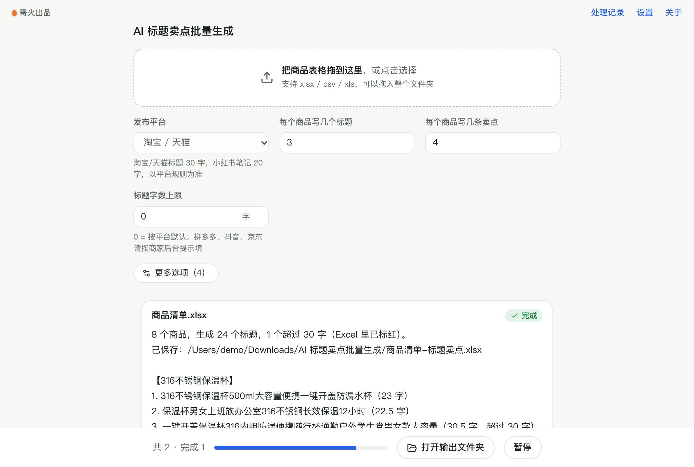

# AI 标题卖点批量生成

> 篝火出品 · 收录于篝火 App 应用区

Excel 进、Excel 出，可指定平台字数规则



## 下载

到 [Releases](https://github.com/campfire-code/ai-title-writer/releases/latest) 下载对应安装包：

| 电脑 | 文件 |
|---|---|
| Windows 10 / 11 | `ai-title-writer_版本号_windows-x64-setup.exe` |
| Mac（Apple 芯片） | `ai-title-writer_版本号_mac-arm64.dmg` |
| Mac（Intel 芯片） | `ai-title-writer_版本号_mac-x64.dmg` |

第一次打开：
- **Windows**：如果弹出「Windows 已保护你的电脑」，点「更多信息」→「仍要运行」。
- **Mac**：如果提示「无法验证开发者」，打开「系统设置 → 隐私与安全性」，在下方点「仍要打开」。

## 怎么用

**第一次用：先在「设置」里填大模型。** 打开右上角「设置」，选一个服务商（推荐 DeepSeek 或通义千问，便宜、中文好），填上自己的 API 密钥和模型名。调用费用由你自己的账号承担，密钥只保存在本机。

1. 准备商品表格（.xlsx 或 .csv），一行一个商品。至少要有一列商品名，其他列（品类、卖点关键词、规格、适用人群……）越全，写出来越准。
2. 把表格拖进窗口。
3. 选「发布平台」，设好每个商品写几个标题、几条卖点（3～5 条）。
   - 字数上限：淘宝/天猫按 30 个汉字算（英文和数字算半个），小红书笔记标题按 20 字算；拼多多、抖音、京东的上限经常调整，请按商家后台提示在「标题字数上限」里自己填。**一切以平台最新规则为准。**
4. 商品名列一般能自动认出（表头叫「商品名称」「品名」「产品名称」等）；认不出时在「更多选项」里填列名或列字母。默认参考其他所有列，也可以指定只参考哪几列。
5. 点「开始处理」。处理完在原文件旁边（或你选的保存位置）生成「原文件名-标题卖点.xlsx」：原来的列都保留，后面加上「标题1…标题N」「卖点」「提示」列。

**会自动帮你做的检查**
- 超过字数上限的标题在 Excel 里**标红**，结果区也会写「超过 30 字」。
- 自动去掉「最」「第一」「国家级」「顶级」「100%」等常见广告法极限词，去掉了哪些写在「提示」列。词表不是完整清单，发布前请再人工过一遍。
- 某个商品生成失败（比如网络抖动）不影响其他商品，原因写在「提示」列，并标红。
- 没有设置大模型、密钥不对时，整份表直接失败并提示去「设置」里检查，不会白白调用。

**费用参考**：每个商品调用一次大模型（同时最多 3 个），表格一次最多 500 个商品。

## 验收用例

需要先在「设置」里填好可用的大模型。大模型每次写的内容不同，下面只核对结构和规则。

| 操作 | 应得到 |
|---|---|
| 拖入 `samples/商品清单.xlsx`，平台选「淘宝 / 天猫」，其他保持默认，点「开始处理」 | 结果区显示「8 个商品，生成 24 个标题，…」；输出 `商品清单-标题卖点.xlsx`，8 行商品，前 6 列与原表一致，后面依次是「标题1」「标题2」「标题3」「卖点」「提示」；卖点每格 4 条，带 1. 2. 编号 |
| 打开上面的输出文件，检查标题长度 | 超过 30 字（英文数字算半个）的标题单元格是红字浅红底，「提示」列写「N 个标题超过 30 字」；没超的不标红 |
| 在输出文件里搜「最」「第一」「国家级」 | 标题和卖点里都搜不到；如果模型写了，被去掉的词记录在「提示」列 |
| 平台改「小红书笔记」再处理一次 | 字数按 20 字检查，结果区写「都在 20 字以内」或「N 个超过 20 字」 |
| 「设置」里清空密钥后处理 | 列表显示失败：「还没有设置大模型：请到「设置」里填写接口地址、密钥和模型名」 |
| 「商品名在哪一列」填 `价格` | 列表显示失败：「找不到列「价格」，表头是：商品编号、商品名称、品类、卖点关键词、规格、适用人群」 |

自动测试（`pnpm test`）用假的大模型回复跑通了完整流程，包括模型回复带代码块、中文键名、缺字段、解析失败重试等情况。

## 自己编译

需要 Node.js 22、pnpm、Rust。

```bash
pnpm install
pnpm test          # 单元测试
pnpm tauri dev     # 开发运行
pnpm tauri build   # 打包
```

界面框架在 `src/kit`（所有 campfire-code 工具共用），本工具的逻辑在 `src/tool`。

## 归属

本工具由**篝火**出品，是篝火 App 应用区收录的开源工具之一，由篝火（GitHub 组织 [campfire-code](https://github.com/campfire-code)）维护与更新。全部工具的目录见 [toolkit-hub](https://github.com/campfire-code/toolkit-hub)。

## 许可证

MIT，版权方为篝火（campfire-code）。
